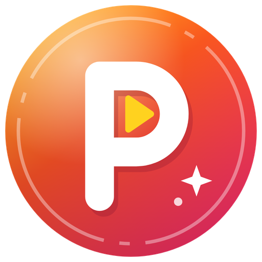

<div align="center">

<a href="https://paginita-pro.cl">
  
</a>

# Paginita Pro

**Herramientas de laboratorio y juegos en línea, todo en el navegador.**
Sin instalar nada, gratis y hecho a la medida de nuestro grupo.

### 👉 [paginita-pro.cl](https://paginita-pro.cl)

[](https://paginita-pro.cl)
[](https://paginita-pro.cl/juegos.html)


</div>

---

## ¿Qué es?

Paginita Pro (antes «Laboratorio») es un sitio estático que reúne una pequeña
colección de aplicaciones que corren **enteras en tu navegador**: no hay
servidor propio. Las herramientas de laboratorio funcionan incluso sin
conexión, y las colaborativas guardan sus datos en Firebase para que varias
personas trabajen a la vez.

La puerta de entrada es el menú de [Inicio](https://paginita-pro.cl/Inicio.dc.html),
desde donde se llega a cada aplicación.

## 🧰 Aplicaciones

| | Aplicación | Para qué sirve |
|:-:|---|---|
| 📈 | **[CSV·Scope](https://paginita-pro.cl/CSV%20Oscilloscope.dc.html)** | Osciloscopio offline para capturas CSV: cursores, trigger, FFT, armónicos con THD y TDD (IEEE 519), canales matemáticos y modo XY. |
| 🎛️ | **[FiltroLab](https://paginita-pro.cl/Filtros.dc.html)** | Diseño de filtros activos desde la plantilla de bandas: orden mínimo, f₀ y Q de cada etapa, diagrama de Bode y cómo queda tu señal al pasar por el filtro. |
| 📐 | **[AjusteLab](https://paginita-pro.cl/Ajustes.dc.html)** | Ajuste de curvas a tus medidas: parámetros con su σ, χ² y residuos, magnitudes derivadas con incertidumbre propagada, y de ahí la tabla en LaTeX y la figura del informe. |
| 📝 | **[ColabTeX](https://paginita-pro.cl/colabtex.html)** | Editor LaTeX colaborativo al estilo Overleaf: proyectos, edición en tiempo real, compilación a PDF en el navegador y control de versiones. |
| ✏️ | **[ColabDraw](https://paginita-pro.cl/colabdraw.html)** | Editor de dibujos vectoriales al estilo Inkscape para las figuras de tus artículos, exportable a SVG y PNG, con la misma cuenta de ColabTeX. |
| 🎮 | **[Juegos](https://paginita-pro.cl/juegos.html)** | Salas multijugador, Solo Club con rankings, monedas, logros, perfiles, Casino, PRODROP, Mascotas 3D y PRO HERO. ¡Detalles abajo! |
| ⚑ | **[Informes](https://paginita-pro.cl/informes.html)** | El buzón de errores y sugerencias compartido: lo que recogen las apps y lo que escribe el equipo, en un solo lugar y exportable. |

## 🎮 Juegos

La sección más grande del sitio. Se instala como app en el celular y todo se
juega con tu cuenta: ganas monedas, desbloqueas logros y personalizas tu
perfil con marcos, fondos y tu mascota.

<table>
<tr>
<td valign="top" width="50%">

**👥 Salas en línea** — juega con amigos

Ajedrez · Pool 8 · UNO · Catan · Clue · Cacho · Presidente · Spicy ·
Flip 7 · Reversi · Cuadritos · Órbita · Chain Reaction · Cartas
(Card‑Jitsu) · Escondite · Gato (y Super Gato) · Tetris · Memazo · Pokémon · Tulones ·
HaxBall · Circuit Breakers · Yemas · Pro BoxHead · PRO HERO ·
Budokai Tenkaichi 3 · Mario Kart Wii

</td>
<td valign="top" width="50%">

**🏆 Solo Club** — un jugador, con clasificación

Tetris · sortEm · BBTAN · 2048 · Sudoku Arcade · Sopa de letras ·
Electrodle · Integrodle · FANAL · ALETEO · Trigon · PRO TILES · Atasco ·
Metro Rush · Mina Club · Frontera Batalla · Tulones · PRO DEFENDER ·
PRO PACMAN · Snake · Pokelike *(en construcción)*

</td>
</tr>
</table>

Y además:

- 🎰 **Casino** — el avión, el pingüinito, ruleta, blackjack, póker y plinko (con monedas del juego, claro).
- 🃏 **PRODROP** — sobres de cartas coleccionables de fútbol, tu plantilla y un mercado para intercambiarlas.
- 🐾 **Mascotas** — crías una mascota 3D, la alimentas, la llevas al Pueblo a visitar a las de tus amigos.
- 🎸 **PRO HERO** — guitarra al estilo Clone Hero, con modo batalla y salas en línea.
- 🛒 **Mercado, tienda y perfiles** — compra, vende e intercambia; marcos y fondos animados para lucirte en la clasificación.

## 🏗️ Cómo está hecho

- **Sitio estático** publicado con GitHub Pages en [paginita-pro.cl](https://paginita-pro.cl).
- **Sin backend propio**: todo corre en el navegador; la persistencia de las apps colaborativas y de los juegos vive en **Firebase** (Realtime Database, Auth y Storage).
- **ColabTeX** compila LaTeX en el propio navegador (BusyTeX) y sincroniza la edición con **Yjs**.
- **Mascotas** usa React + three.js; el resto es JavaScript empaquetado con **esbuild**.
- Las páginas están en **español**, con selector de idioma para verlas en inglés o italiano.

### Estructura

```
Inicio.dc.html          menú principal (index.html redirige aquí)
*.dc.html + *-engine.js CSV·Scope, FiltroLab y AjusteLab
colabtex.html           ColabTeX       ┐
colabdraw.html          ColabDraw      │  bundles generados (*-app.js)
juegos.html             Juegos         │  desde colabtex/src/
informes.html           Informes       ┘
juegos/                 juegos en iframe (Solo Club, PRO HERO, Mascotas…)
colabtex/               espacio de build: código fuente, tests y node_modules
firebase/               reglas de seguridad de la base de datos
marca/                  logo y favicons
docs/claude/            notas técnicas de cada app y cada juego
```

## 🚀 Probarlo en tu computador

Todo se construye desde `colabtex/`:

```bash
cd colabtex
npm install      # solo la primera vez
npm run build    # empaqueta las apps y estampa las versiones
npm start        # servidor local en http://localhost:8123
```

Luego abre <http://localhost:8123/Inicio.dc.html>. En Windows basta con hacer
doble clic en `Iniciar ColabTeX.cmd`.

> [!NOTE]
> Hay que abrir el sitio **a través del servidor**, no con doble clic en el
> archivo: con `file://` el inicio de sesión de Google y la compilación de
> LaTeX no funcionan.

Los juegos tienen sus pruebas con `npm run test:juegos`.

---

<div align="center">

Hecho con cariño por el equipo de Paginita Pro · **[paginita-pro.cl](https://paginita-pro.cl)**

</div>
